# EduSignal: AI-Powered Student Success & Early Warning System

**Predict + Explain + Recommend + Monitor + Intervene**

A Streamlit platform that predicts a student's final score, flags students at risk, explains why, recommends what to improve first, and helps teachers intervene early.

The interface is in English: clear and professional in the teacher and admin portals, and warm and
encouraging in the student portal (the same page shows student-friendly wording when a student is signed in).

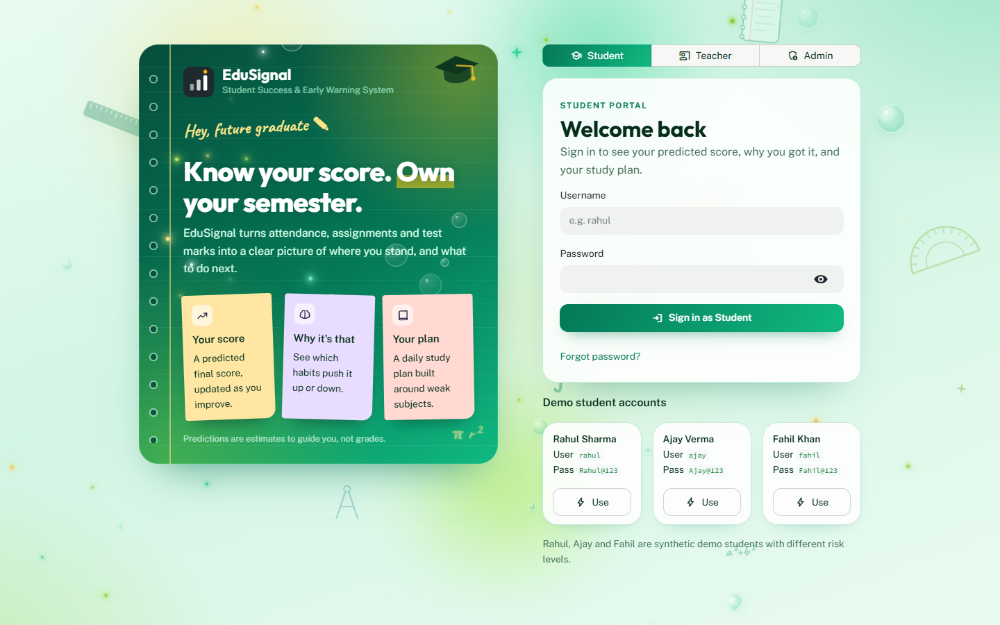

> **Status: working prototype.** The bundled dataset has 10 records. It is suitable for demonstrating the prototype but is insufficient for strong real-world generalisation. See [Limitations](#20-limitations).

---

## 1. Problem statement

Most student performance tools stop at a number: *"Your predicted score is 65."* That does not tell a student what to do, or tell a teacher who needs help first. By the time final results arrive, it is too late to act.

## 2. Motivation

Early signals of difficulty, such as falling attendance, missed assignments and weak internal marks, are usually visible weeks before a final exam. They are scattered across registers and gradebooks, and nobody combines them into a single, explained warning with a concrete next step.

## 3. Proposed solution

A single system that takes the signals an institution already records and answers ten questions for each student:

1. What is the predicted performance?
2. Is the student at risk?
3. Why?
4. Which factors affect performance most?
5. What should be improved first?
6. What study plan should the student follow?
7. What happens if a factor improves?
8. Is performance improving or declining?
9. Should a teacher intervene?
10. What should happen next?

## 4. USP

The system goes beyond prediction. Every output is **explained and actionable**:

| Step | What the system does |
|---|---|
| Predict | Estimates the final score, grade and category |
| Explain | Shows each factor's exact contribution (Shapley values) |
| Recommend | Ranks improvements by the model's estimated gain |
| Monitor | Tracks each student's records over time |
| Intervene | Flags students for teachers and logs intervention plans |

## 5. Features

| Area | Feature | Where |
|---|---|---|
| A | Prediction: score, grade, category, comparison with training data | Prediction |
| B | Early warning: multi-factor risk score with traceable rules | Early warning |
| C | Explainable AI: contribution waterfall, drivers, plain-language summary | Explainable AI |
| D | What-if simulator: before/after, risk change, sensitivity curves | What-if simulator |
| E | Personalised study plan: priorities, today's plan, weekly plan | Study plan |
| F | Performance trend: history per student, decline detection | Student profile, Overview |
| G | Subject-wise performance: strong, weak and priority subjects | Student profile, Study plan |
| H | Teacher dashboard: KPIs, filters, sortable roster | Teacher dashboard |
| I | Early intervention: generated plan, follow-up date, status log | Teacher dashboard |
| J | Student profile: summary, strengths, weaknesses, history | Student profile |
| K | Attendance intelligence: configurable target, gap, classes needed | Early warning |
| L | Assistant: rule-based, answers only from the student's own data; private chat history (new, previous, delete) | Assistant |
| M | Notifications: in-app centre with read/unread; email (SMTP) and SMS (Twilio or webhook) when configured, with a real delivery log | Notifications, Users & security |
| N | Admin dashboard: institution KPIs, department/class stats | Admin dashboard |
| O | CSV import: row-level validation with specific error messages | Data import |
| P | Model pipeline: load, validate, train, evaluate, save with metadata | `ml/train_model.py` |
| Q | Model comparison: R², MAE, RMSE from cross-validation | Model management |
| R | Data quality report: statistics, outliers, correlations | Analytics & data quality |
| S | Responsible AI: limitations page | AI limitations |
| T | Attendance sessions and assessment marks, with predictions recomputed from them | Attendance & marks |
| U | Study plan tracking: Pending / In Progress / Completed per task, saved in the database, progress % | Study plan |
| V | PDF and Excel reports: attendance, marks, performance, AI prediction, study plan (role-based) | Reports |
| W | Training data readiness: real-data sources, duplicates, hold-out test set from 40 rows | Model management |
| X | Users and security: accounts, deactivation, audit log, import history, academic structure | Users & security |

**Role-based sign-in.** The sign-in screen has separate Student, Teacher and Admin tabs. An account can only sign in through its own role, and each role lands on its own home page (Student: Overview, Teacher: Teacher dashboard, Admin: Admin dashboard). Passwords are hashed with PBKDF2, and five failed attempts lock the account for 60 seconds (stored in the database, so a refresh does not reset it).

## 6. System architecture

EduSignal is a **Streamlit application** with an internal service layer over SQLite. The pages in `views/`
call the services in `services/`; the services check permissions, validate input, run related writes in
one transaction and write an audit entry. There is no separate HTTP API because the app does not need one:
every page runs server-side in the same process, and the browser never talks to the database directly.

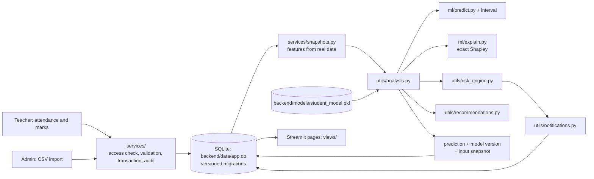

Every page reads one shared analysis result (`utils/analysis.py`), so the numbers on different pages always agree.

```
project/
├── app.py                      # launcher only: `streamlit run app.py` (calls frontend/main.py)
├── requirements.txt
├── .env.example                # optional environment settings (placeholders only)
├── .streamlit/config.toml      # Streamlit settings (must stay in the root)
│
├── frontend/                   # EVERYTHING the user sees (Streamlit)
│   ├── main.py                 # page setup, sign-in, access check, student context, navigation
│   ├── assets/                 # logos
│   └── views/                  # pages and components
│       ├── login.py            # role-based sign-in scenes
│       ├── student_pages.py    # Overview, Prediction, Explainable AI, What-if, Study plan, Early warning, Profile
│       ├── staff_pages.py      # Teacher dashboard, Analytics
│       ├── records_pages.py    # Attendance & marks
│       ├── admin_pages.py      # Admin dashboard, Data import, Model management
│       ├── security_pages.py   # Users & security, Email / SMS
│       ├── reports_pages.py    # PDF / Excel reports
│       ├── account_pages.py    # Notifications, Settings, AI limitations
│       ├── assistant_panel.py  # corner assistant with chat history
│       ├── common.py           # shared UI components and cached loaders
│       └── theme.py            # role themes, animated background, CSS
│
├── backend/                    # EVERYTHING behind the UI (no Streamlit code)
│   ├── config.py               # paths, feature schema, thresholds, lockout settings
│   ├── data/                   # student_performance.csv, app.db (git-ignored), backups/ (git-ignored)
│   ├── models/                 # trained model bundle + metadata
│   ├── database/
│   │   ├── database.py         # connection + core queries (PostgreSQL-ready SQL)
│   │   ├── migrations.py       # versioned, transactional migrations, backup, integrity report
│   │   └── manage.py           # CLI: status, backup, migrate, seed, seed-demo, check
│   ├── services/               # business logic: access, audit, academics, attendance, assessments,
│   │                           # snapshots, models, imports, seed, study_plan, reports, training, chat
│   ├── ml/                     # training, prediction, explanation
│   └── utils/                  # analysis, risk engine, recommendations, assistant, notifications, auth, validation
│
├── tests/                      # test_core.py (model/logic), test_backend.py (database, security, services)
└── docs/screenshots/           # README screenshots

Rule of thumb: change how something **looks** in `frontend/`; change how something **works** (data, rules,
predictions, permissions) in `backend/`. The frontend imports from the backend; the backend never imports the frontend.
```

### Database schema

Created and upgraded by `database/migrations.py` (each migration runs once, inside a transaction, after a backup):

| Area | Tables |
|---|---|
| Identity and security | `users` (role, active flag, failed attempts, lock-until, last sign-in), `audit_log` |
| Academic structure | `departments`, `programs`, `academic_terms`, `subjects`, `class_sections`, `enrollments` (unique per student and term), `teacher_subjects`, `teacher_classes` |
| Students and records | `students` (registration number, programme, semester, status), `academic_records`, `subject_scores` |
| Attendance | `attendance_sessions` (unique per class, subject, date and period), `attendance_records` (present / absent / late / excused) |
| Assessments | `assessments` (assignment / internal / quiz / semester, max marks), `assessment_marks` (0 to max, or absent) |
| AI and success | `model_versions`, `predictions` (model version, exact input snapshot, 80% interval), `risk_assessments`, `recommendations`, `interventions` |
| Operations | `notifications` (read/unread), `import_batches`, `import_errors`, `settings`, `schema_migrations` |

Foreign keys are enforced, marks and dates have CHECK constraints, and the integrity check
(`python -m backend.database.manage check`) also looks for orphaned records and marks above the maximum.

### Where the model's inputs come from

When a teacher presses **Update predictions** on *Attendance & marks*, each student's inputs are rebuilt from real data:
attendance = attended ÷ held sessions (present and late count, excused is left out); assignment score = average % of
assignments and quizzes; internal marks = average % of internal tests and semester exams. Study hours and previous marks
are not measured by the app, so they are carried forward from the latest record and labelled as such. The saved
prediction stores the model version and these exact inputs, so it can be reproduced later.

### Security

* Passwords: PBKDF2-SHA256, 200,000 iterations, per-user salt. No plaintext passwords are stored.
* Sign-in: the role tab must match the account; wrong username, wrong password and wrong role all give the same message.
  After 5 failures (configurable) the account is locked for 60 seconds, stored in the database, so a refresh does not reset it.
* Deactivated accounts cannot sign in, and are signed out on their next page load.
* Authorization is checked on the server for every student opened and every write: students see only their own record;
  teachers manage only their assigned classes; imports, user management and retraining are admin-only.
* All SQL uses parameters. Sign-ins, data changes, imports, retraining and denied access are written to the audit log.

## 7. ML workflow

```
Data loading -> Validation -> Model comparison (cross-validation) -> Sanity check
-> Selection -> Fit on all data -> Save bundle -> Prediction + Explanation
```

## 8. Technology stack

Python 3.12, Streamlit, scikit-learn, pandas, NumPy, Plotly, joblib, SQLite, openpyxl (Excel reports) and
reportlab (PDF reports). No paid APIs; email and SMS use the standard library (`smtplib`, `urllib`) and only run
when configured. Explainability is implemented directly rather than through the `shap` package.

## 9. Dataset

`backend/data/student_performance.csv`, as provided:

| Property | Value |
|---|---|
| Rows | 10 |
| Columns | 6 (5 inputs + `Final_Score`) |
| Missing values | 0 |
| Duplicate rows | 0 |
| Lowest correlation between any two columns | 0.97 |
| Final score range | 52 to 95 (mean 75.5) |

Inputs: `Attendance` (%), `Assignment_Score`, `Internal_Marks`, `Study_Hours` (per day), `Previous_Marks`.

The near-perfect correlation between every pair of columns suggests hand-made sample data. It makes it impossible to reliably separate the effect of one factor from another.

The CSV has no student IDs, names or dates, so none were invented: its rows appear in the app as `CSV-01` to `CSV-10` ("Dataset record n").

**Synthetic demo data.** 36 synthetic students (weekly records and subject scores) are loaded automatically on first run so the dashboards, trends and subjects can be demonstrated. They have realistic names such as Rahul Sharma, carry a demo badge everywhere, are never used for training, and an admin can remove them (and load them again) from the Admin dashboard. Once removed, they are not re-added automatically.

## 10. Model training

```bash
python -m backend.ml.train_model
```

Five candidates are compared, each as a scikit-learn `Pipeline`:

- Baseline (always predicts the mean)
- Linear Regression
- Ridge Regression (standardised)
- Random Forest
- Gradient Boosting

With fewer than 30 rows, evaluation uses **leave-one-out cross-validation**: every record is predicted by a model that never saw it. With 30 or more rows it switches to 5-fold cross-validation. The original 80/20 split tested on only 2 rows and has been replaced.

**Sanity check.** Each model is tested for whether its prediction ever falls when an input rises (for example, more attendance leading to a lower predicted score). A drop of more than 0.5 points fails. The selected model is the lowest-RMSE model among those that pass.

The saved bundle includes the pipeline, feature names, metrics, the comparison table, training ranges, background data for explanations, a timestamp and the scikit-learn version.

**Training on real data (Model management, Retrain).** The training set is assembled from
`backend/data/student_performance.csv` plus database records that have an actual `Final_Score` and are *not* synthetic demo
data. Rows are validated with the import rules, exact duplicates across sources are counted once, and rejected rows
are shown with their reason. From **40 rows**, 20% is split off first as a test set that is never used for model
selection; its MAE/RMSE/R² are shown next to a predict-the-mean baseline. Below 30 rows the page warns that the model
is for demonstration only and not production-ready; 100+ rows are recommended.

**Data needed to make the model reliable** (one row per student per term, imported through Data import):

| Column | Meaning |
|---|---|
| `Attendance` | Term attendance % (0-100) at the time of the record |
| `Assignment_Score` | Average assignment mark (0-100) |
| `Internal_Marks` | Average internal test mark (0-100) |
| `Study_Hours` | Average self-study hours per day (0-24) |
| `Previous_Marks` | Previous term's final mark (0-100) |
| `Final_Score` | The actual final result (0-100), known after the exam: what the model learns |

Optional: `Student_ID`, `Name`, `Department`, `Class_Section`, `Record_Date`, `Classes_Held`, `Classes_Attended`.
Aim for at least 100 such rows from past terms, covering every department, before relying on predictions.

## 11. Evaluation

Actual results on the provided 10-row dataset (leave-one-out cross-validation):

| Model | R² | MAE | RMSE | Sanity check |
|---|---|---|---|---|
| Baseline (predict the mean) | -0.235 | 12.89 | 14.88 | Pass |
| Linear Regression | 0.996 | 0.44 | 0.83 | **Fail** (prediction can drop 22 points as an input rises) |
| **Ridge Regression (selected)** | **0.998** | **0.54** | **0.66** | Pass |
| Random Forest | 0.910 | 2.72 | 4.03 | Pass |
| Gradient Boosting | 0.909 | 3.38 | 4.05 | Pass |

**How to read this.** These numbers come from 10 held-out predictions on unusually clean data. They are not evidence that the model will be this accurate on real students; with real data, expect much larger errors.

**Why Linear Regression was rejected.** Fitted to this data, plain linear regression gives attendance a weight of -0.25, assignments -0.50 and study hours 0.00. It fits the 10 rows almost perfectly while telling students that attending more lowers their score. The originally submitted model had an assignment weight of -0.33 for the same reason. Ridge regression gives every input a positive weight:

| Input | Ridge weight (points per unit) |
|---|---|
| Attendance | +0.20 |
| Assignment score | +0.19 |
| Internal marks | +0.21 |
| Study hours/day | +1.88 |
| Previous marks | +0.20 |

Because the inputs are so correlated, these weights describe how the model spreads credit, not the true effect of each factor.

**Uncertainty.** Each prediction is shown with an ~80% range whose width comes from the cross-validated
(held-out) residuals, not from training error. On the current data it is narrow (about ±1 point) only because
the 10 rows are unusually clean; expect it to widen substantially on real records.

**Checked against real outcomes.** Model management compares predictions and High-risk flags with actual final
scores (MAE, interval coverage, precision and recall of "High risk" for failing below the pass mark). It uses only
records that were *not* used for training. Today there are none, so the page says so instead of showing numbers;
the check fills in as records with real final scores are imported.

**Model versions.** Every trained model is registered (`model_versions`) with its metrics, dataset fingerprint and
library version, and every saved prediction stores the version and the exact inputs used.

## 12. Explainable AI

The system computes **exact Shapley values**, the quantity the SHAP library estimates. With 5 inputs there are only 32 combinations of factors, so no approximation is needed. For each factor, the model is evaluated with and without the student's real value across every combination of the other factors, filling missing factors from the training data.

Properties:

- The contributions add up **exactly** to *this prediction minus the average prediction* (verified in `tests/test_core.py`).
- For the linear model they match the closed-form result, coefficient × (value − mean), to 4 decimal places.
- The method works for any model type, so explanations keep working if a tree model is selected after retraining.

The page shows a contribution waterfall, factors raising and lowering the prediction, average importance across all students, and a plain-language summary generated only from the computed values. It also states that contributions describe **how the model uses its inputs, not what causes a student's result**.

## 13. Early warning system

Risk is **not** based only on the predicted score. Each rule adds points to a 0–100 risk score, and each point is shown with the student's value, the threshold and the reason.

| Rule | Risk points |
|---|---|
| Predicted score below pass mark (50) | 35 |
| Predicted score below watch level (70) | 15 |
| Attendance below target (75%) | 10 + 0.75 per point below, max 25 |
| Assignment score below 60 | 8 + 0.35 per point below, max 15 |
| Internal marks below 60 | 8 + 0.35 per point below, max 15 |
| Study time below 3 h/day | 10, or 15 if below half |
| Previous marks below 50 | 10 |
| Predicted score fell 5+ points since last record | 15 |
| 2 of the last 3 records below pass mark | 15 |

**Levels:** 🔴 High at 50+ points, 🟡 Moderate at 25+, 🟢 Low below 25. A predicted score below the pass mark always counts as high risk.

**Intervention** is recommended for high risk, or for moderate risk with a declining trend.

All thresholds are editable in **Settings** (teacher/admin), so the system does not impose arbitrary institutional rules. The trend rules apply only when a student has at least two records; they are never guessed.

**Attendance intelligence.** Given classes held *t*, attended *a* and target *T*, attending the next *x* classes in a row gives (*a* + *x*)/(*t* + *x*). The system solves for the smallest *x* that reaches *T*, or, if the student is above target, how many classes they could miss. A 100% target after any absence is reported as unreachable.

## 14. Recommendation engine

For each factor a student can still change (attendance, assignments, internal marks, study hours) that is below its target, the engine asks the model: *what is the predicted score if only this factor reaches its target?* Factors are ranked by that estimated gain. Previous marks are shown but never ranked as an action, since they cannot be changed.

The **study plan** splits daily study time (at least the configured target of 4 h/day, at most 8):

- Weak subjects (below 75%) share the main block in proportion to how far each is below 75.
- Assignment catch-up (45 min) and past internal questions (30 min) are added when those factors are below target.
- About 20% of the time goes to revision.

Every block carries a one-line reason. The weekly plan rotates the focus areas, with a timed practice test on Saturday.

## 15. The assistant

Ten one-click questions (plus free-text questions on the same topics): why the score is low, how to improve
attendance, this week's focus, assignments, the factor affecting performance most, reducing risk, current risk level,
daily study hours, the next test, and reaching a target score. Answers are calculated from the student's own
analysis; where an answer gives an estimate (for example "+4.9 points"), it comes from the trained model. The
target-score answer searches small, realistic steps with the model. It is rule-based, makes no external API calls
and invents nothing; the page states this clearly. Questions can be asked in English, and common Hinglish phrasing is understood too.

**Chat history.** Conversations are saved per account and per student context. Only the account that started a
conversation can list, open, continue or delete it (admins included, because a conversation contains a student's
private data). "Nayi Baat Shuru Karein" starts a new one; "Purani Baatein" lists previous ones with a delete button;
deleting removes the messages permanently.

## 16. Screenshots and design

One design system (spacing, type scale, components and motion rules in `views/theme.py`) with a distinct
identity per role, not just a colour swap:

| Portal | Palette and type | Signature |
|---|---|---|
| Student | Green (emerald to mint) with lime and sunshine accents; Outfit headings | "Study notebook": glowing green notebook hero and login with sticky notes and handwritten maths |
| Teacher | Red (wine to crimson) with gold accents; Fraunces serif headings | "Lecture board": crimson board hero and login with chalk diagrams, ruled cards |
| Admin | Gold on charcoal; Space Grotesk, mono numerals | "Command console": dark gold hero with live status, dark sidebar, console login with live counts |

**Living background.** Behind every page and login screen, a lightweight CSS-only layer moves continuously:
soft gradient shapes, twinkling glow stars and particles, rising bubbles and water drops, wandering
role-specific objects (pencil, scale, calculator, protractor, compass, books and cap for students; books, pen,
cap and compass for teachers; charts, gears and hexagons for admins) and mathematical symbols. It only animates
`transform` and `opacity`, never takes clicks, thins out on small screens, and stops when the device asks for
reduced motion.

Risk levels keep their own green, amber and red, and are always shown with a label as well as a colour.

Key screens:
- **Prediction:** a score ring with a plain-language verdict, grade, risk and an honest confidence level; a
  pass/watch scale showing the typical error range; "what this means"; the factors adding or removing points;
  and tabs for inputs vs targets, trend (with measure and range filters), comparison with training records or
  current students, and model details.
- **Overview:** predicted score, risk level with its main factors, recent progress chart, recommended actions and study suggestions.
- **What-if simulator:** quick buttons and sliders, a before/after result card, and a plain-language explanation of each change. Every number is a real model prediction.
- **Early warning:** the selected student's risk on a chalkboard (reasons and actions), plus a "focus on these students first" watchlist for staff.
- **Assistant (bottom-right corner):** each role has its own assistant and logo: *Study Coach* (cap and spark),
  *Mentor Assist* for teachers (open book, graduation cap and a neural constellation) and *Insight Desk* for admins.
  A spinning ring and dot show the selected student's risk level, and a one-time hint names their biggest
  improvement lever. Clicking opens a chat window with a target gauge, quick questions and free text.
  It is rule-based, not a generative AI chatbot, and says so in the window.
- **Teachers and classes:** each teacher sees only the students in their classes. An admin never lands in a
  teacher's dashboard automatically: on the Admin dashboard's faculty directory, or on the Teacher dashboard page,
  they **select a teacher** (dropdown or card showing avatar, subject, classes, students, high-risk count,
  average score and open plans) and press **View teacher dashboard**. A bar at the top shows whose view it is,
  with a **Switch teacher** dropdown and **Back to teacher list**. **Edit** changes a teacher's subject and classes.

All screenshots are taken from the running application and show **synthetic demo students**.

| | |
|---|---|
|  | 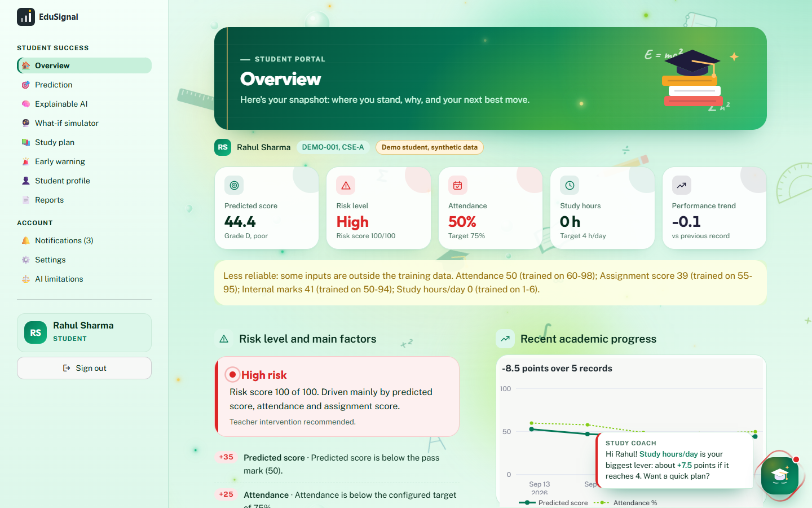 |
| Sign-in (Student) | Student overview (Rahul, demo) |
| 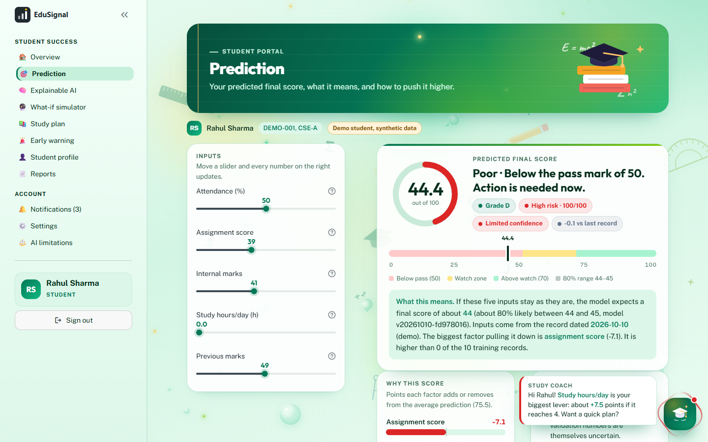 | 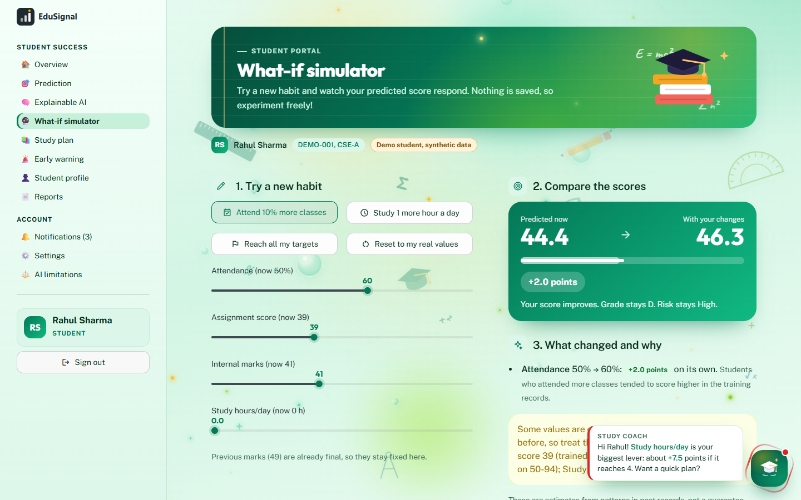 |
| Prediction with confidence and 80% range | What-if simulator |
| 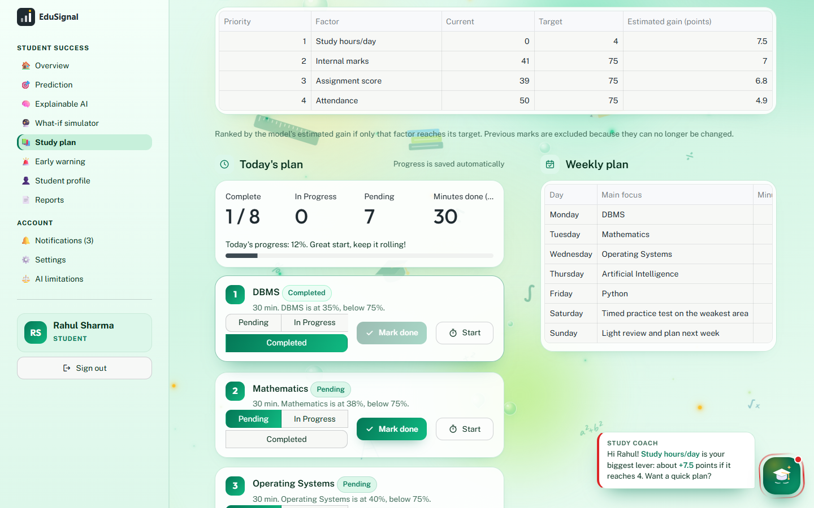 | 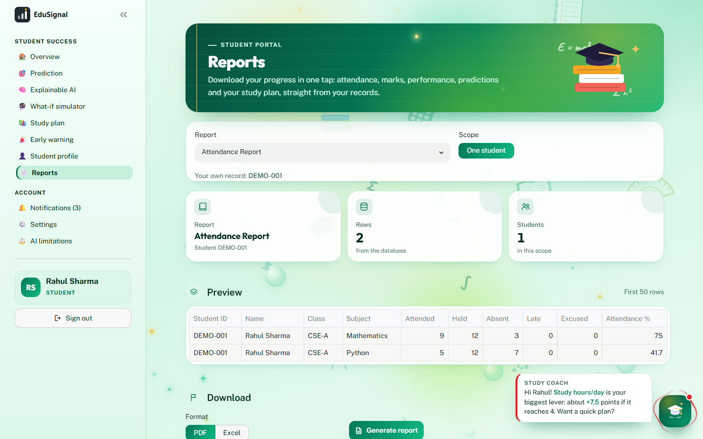 |
| Study plan tracking | Reports (PDF / Excel) |
| 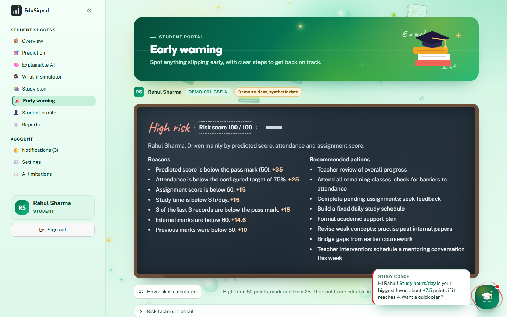 | 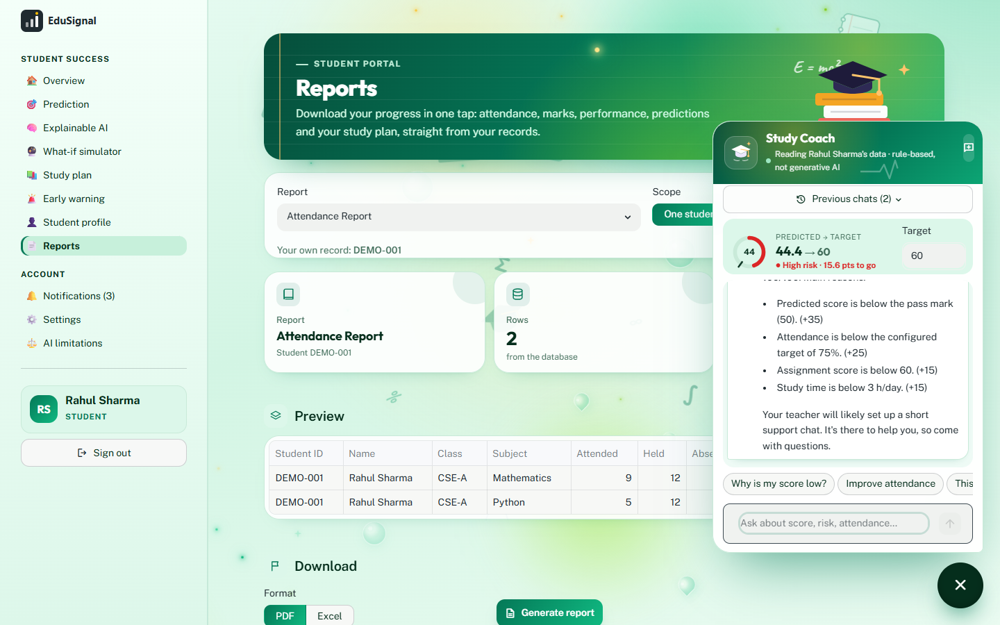 |
| Early warning chalkboard | Assistant with chat history |
| 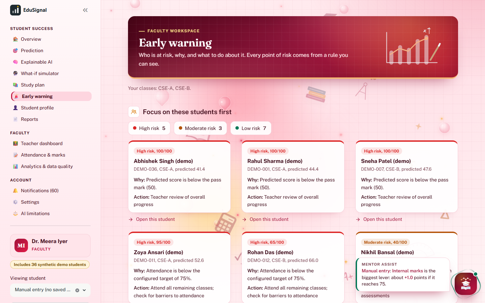 | 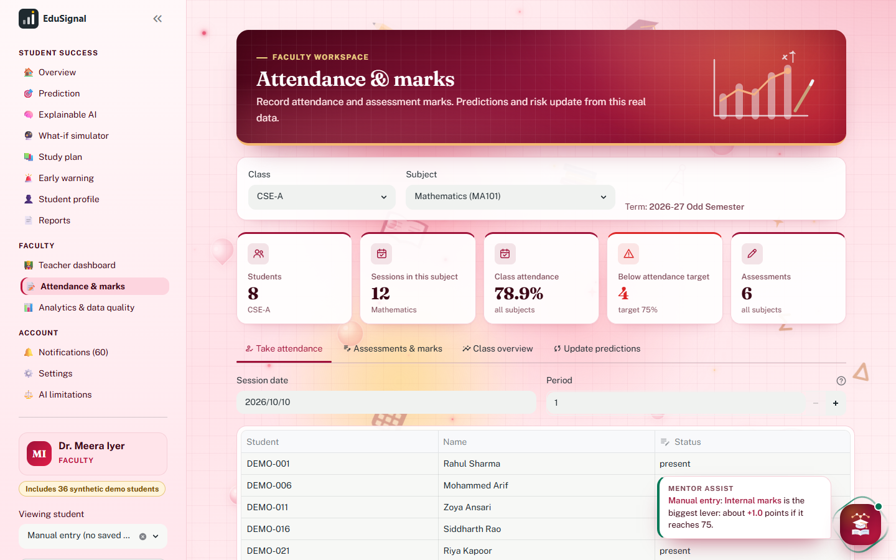 |
| Teacher: students to focus on first | Teacher: Attendance & marks |
| 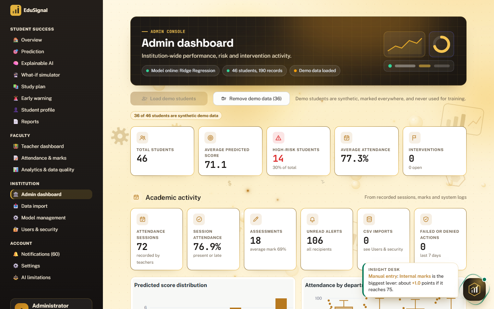 | 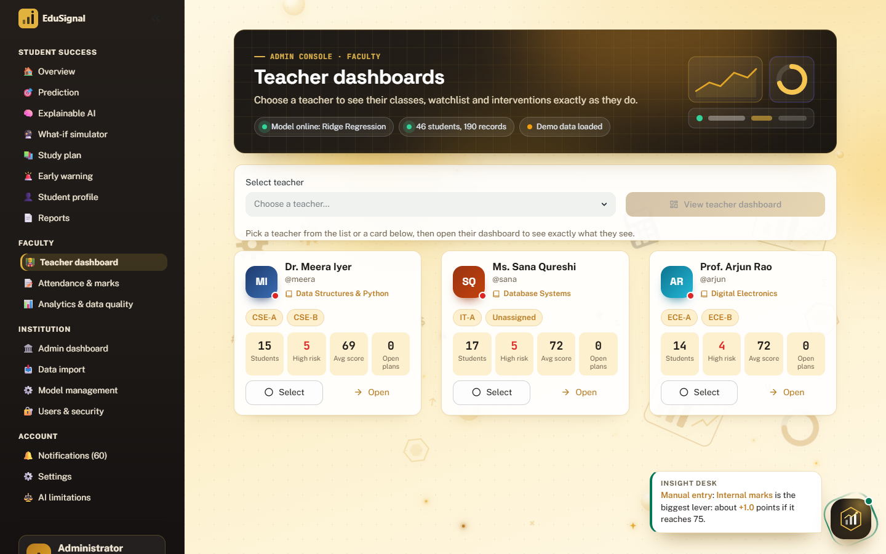 |
| Admin dashboard | Admin: select a teacher, then view their dashboard |
| 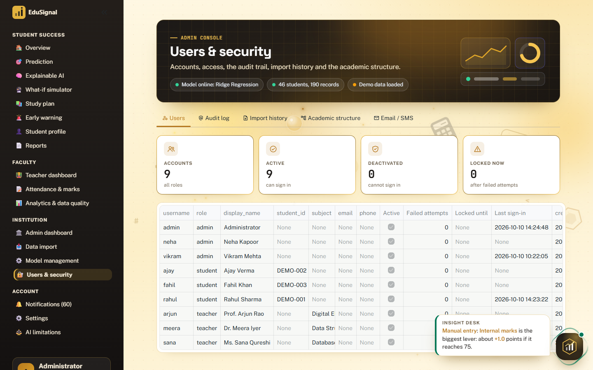 | 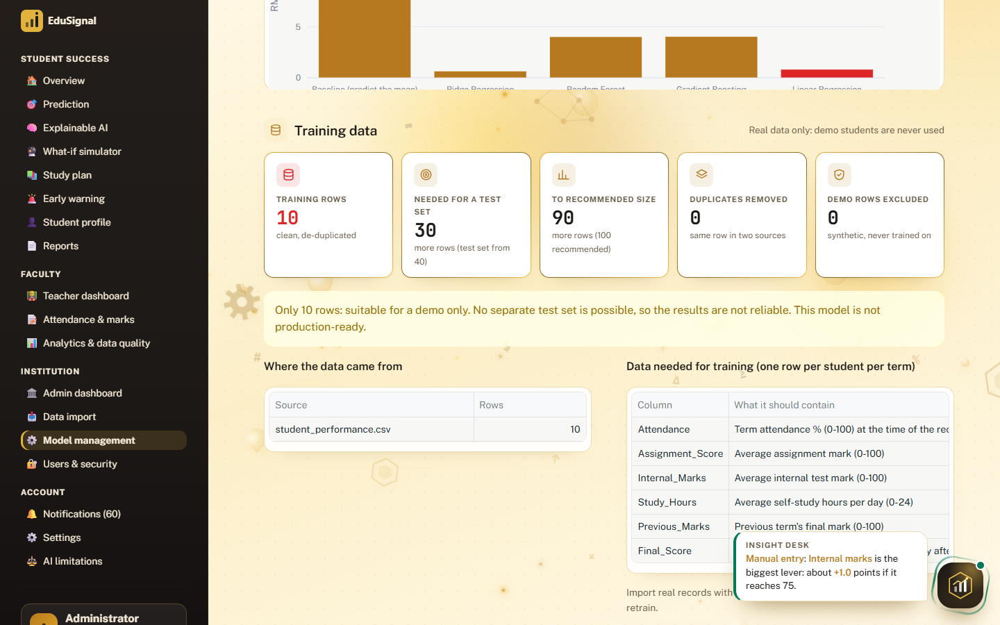 |
| Admin: Users & security | Admin: training data readiness |

## 17. Installation

Requires Python 3.10 or later.

```bash
cd project
python -m venv .venv
# Windows: .venv\Scripts\activate    macOS/Linux: source .venv/bin/activate
pip install -r requirements.txt
python -m backend.ml.train_model        # recommended: retrain with your installed scikit-learn
```

Retraining is recommended because a pickled model should be loaded with the same scikit-learn version that saved it. If you skip it and the saved model fails to load, the app retrains automatically and shows a notice.

**Database setup.** The app migrates and seeds the database by itself on start. To do it explicitly:

```bash
python -m backend.database.manage status      # applied/pending migrations and row counts
python -m backend.database.manage backup      # consistent copy into backend/data/backups/
python -m backend.database.manage migrate     # back up, then apply pending migrations (never drops data)
python -m backend.database.manage seed        # academic structure + demo accounts (safe to repeat)
python -m backend.database.manage seed-demo   # also synthetic demo students, attendance and marks (safe to repeat)
python -m backend.database.manage check       # integrity, foreign keys, orphans; exit code 1 on problems
```

**Environment variables.** All optional; set them in your shell or hosting environment (see `.env.example`,
placeholders only, never commit real values):

| Variable | Purpose |
|---|---|
| `EDUSIGNAL_DB_PATH` | Database file (default `backend/data/app.db`) |
| `EDUSIGNAL_MAX_LOGIN_ATTEMPTS`, `EDUSIGNAL_LOCKOUT_SECONDS` | Login lockout (default 5 attempts, 60 s) |
| `NOTIFY_EXTERNAL_MIN_SEVERITY` | Which alerts go out by email/SMS: `low`, `medium` or `high` (default) |
| `SMTP_HOST`, `SMTP_PORT`, `SMTP_TLS`, `SMTP_USER`, `SMTP_PASSWORD`, `SMTP_FROM` | Email. Sent only when `SMTP_HOST` and `SMTP_FROM` are set |
| `SMS_PROVIDER` (`twilio` or `webhook`), `TWILIO_ACCOUNT_SID`, `TWILIO_AUTH_TOKEN`, `TWILIO_FROM`, `SMS_WEBHOOK_URL`, `SMS_WEBHOOK_TOKEN` | SMS. Sent only when the chosen provider's settings are complete |

Without email/SMS settings, Users & security shows "Configure nahi hai" and the delivery log records
`not_configured`; nothing is ever reported as sent unless the provider accepted it. Users add their email/phone
in Settings, Contact details.

## 18. How to run

```bash
streamlit run app.py
```

Open http://localhost:8501, choose **Student**, **Teacher** or **Admin** on the sign-in screen, and sign in. Each tab lists three demo accounts; press **Use** to fill one in.

Three demo accounts per role are created on first run:

| Role | Name | Username | Password | Lands on |
|---|---|---|---|---|
| Student | Rahul Sharma (high risk, declining) | `rahul` | `Rahul@123` | Overview |
| Student | Ajay Verma (moderate risk, improving) | `ajay` | `Ajay@123` | Overview |
| Student | Fahil Khan (low risk, steady) | `fahil` | `Fahil@123` | Overview |
| Teacher | Dr. Meera Iyer (CSE-A, CSE-B) | `meera` | `Meera@123` | Teacher dashboard |
| Teacher | Prof. Arjun Rao (ECE-A, ECE-B) | `arjun` | `Arjun@123` | Teacher dashboard |
| Teacher | Ms. Sana Qureshi (IT-A, dataset records) | `sana` | `Sana@123` | Teacher dashboard |
| Admin | Administrator | `admin` | `Admin@123` | Admin dashboard |
| Admin | Vikram Mehta | `vikram` | `Vikram@123` | Admin dashboard |
| Admin | Neha Kapoor | `neha` | `Neha@123` | Admin dashboard |

Rahul, Ajay and Fahil are **synthetic demo students** (36 in total, loaded automatically on first run and
shown with a demo badge everywhere). Their risk levels come from the real model, not from hard-coded labels.
The 10 rows of `student_performance.csv` stay labelled "Dataset record N", because the file has no names and
inventing names for real records would be misleading.

**Change these passwords in Settings before any real use.**

**Suggested demo flow:**

1. Choose **Student**, press **Use** on Rahul Sharma and sign in. Walk through Overview, What-if simulator
   (press **Attend 10% more classes**), Early warning and the Assistant.
2. Sign out, choose **Teacher** and sign in as Dr. Meera Iyer. Open **Early warning** to see who to focus on first,
   then on the **Teacher dashboard** click a table row for a quick view and plan an intervention.
3. Sign out, choose **Admin** and sign in. In the **Faculty directory**, select Dr. Meera Iyer and press
   **View teacher dashboard** to see her classes only. Use **Switch teacher** to compare, then **Back to teacher list**.
   **Edit** changes a teacher's subject and classes.

4. As Dr. Meera Iyer, open **Attendance & marks**: save a session in *Take attendance*, enter marks in
   *Assessments & marks*, then *Update predictions* to recompute every student in the class from that data.
5. As an admin, open **Users & security**: deactivate and reactivate an account, see the audit log of steps 1-4,
   import history, and the academic structure (assign a teacher to a subject and class).

**Tests:**

```bash
python -m tests.test_core       # model, explanations, risk rules, validation (4 tests)
python -m tests.test_backend    # 21 tests: migrations, seeding, sign-in and lockout, permissions, attendance,
                                # marks, prediction snapshots, what-if, CSV import, assistant, persistence,
                                # study plan tracking, PDF/Excel reports and their permissions, email/SMS
                                # configuration and delivery status, chat history privacy, hold-out training
```

`test_backend` runs on a temporary database and refuses to touch `backend/data/app.db`.

**Troubleshooting:**

* *"The saved model could not be loaded"*: run `python -m backend.ml.train_model`.
* *An account is locked*: wait for the lock to expire (60 s by default), or an admin can reset its password in Users & security.
* *Something looks wrong with the data*: `python -m backend.database.manage check`. Backups made before every migration are in `backend/data/backups/`.
* *A teacher sees "no classes or subjects assigned"*: an admin assigns them in Users & security, Academic structure.

**Importing data:** Data import, then download the CSV template. The whole file is validated first; valid rows are
written in one transaction, rows already in the database (same Student_ID and Record_Date) are skipped, and every
rejected row is kept with its reason under Users & security, Import history. Rows with a `Final_Score` can optionally
be added to the training set (a backup is kept in `backend/data/backups/`); then retrain from **Model management**, which
records each model version.

**Note:** refreshing the browser page signs you out. This is how Streamlit sessions work. Login lockouts are stored
in the database, so refreshing does not reset them.

## 19. Future scope

- **More and real data.** The single most important improvement. With a few hundred real records, re-run the comparison; the pipeline switches to 5-fold cross-validation automatically.
- **Fairness checks** across groups (department, gender, background) once the data supports them.
- **Calibrated uncertainty** once enough real outcomes exist (the current 80% range is based on 10 held-out predictions).
- **Email/SMS delivery** by implementing the `EmailChannel` stub in `utils/notifications.py`.
- **PostgreSQL:** swap `database.connect()` for a PostgreSQL connection and change `?` placeholders to `%s`. The schema uses only portable types.
- **LLM-backed assistant**, grounded in the same computed analysis so it cannot invent facts.
- **Single sign-on** with the institution's identity provider.
- **Scheduled re-assessment** when new records arrive.

## 20. Limitations

- **Tiny dataset.** 10 records is enough to demonstrate the prototype, not to make reliable predictions about real students. Reported metrics come from very few held-out predictions.
- **Correlated inputs.** Every input moves together in the data, so the model cannot reliably tell which factor matters. Explanations and "estimated gains" show association, not cause.
- **Narrow training ranges.** For example, study hours in the data only go from 1 to 6. Predictions for inputs outside the training ranges are extrapolation, and the app says so.
- **Five inputs only.** The model cannot see illness, family circumstances, workload or motivation.
- **Heuristic risk weights.** The risk points are reasonable, configurable rules, not weights learned from data. They should be reviewed with faculty and validated once outcome data exists.
- **Not for high-stakes decisions on its own.** Predictions support teacher judgment; they must not be the sole basis for grading, progression, scholarships or discipline.
- **Data security.** Records are stored in a local SQLite file. Before real use: change the demo passwords, restrict access to `backend/data/app.db`, encrypt backups and follow your institution's data-protection policy.
